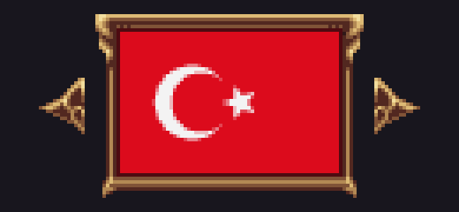
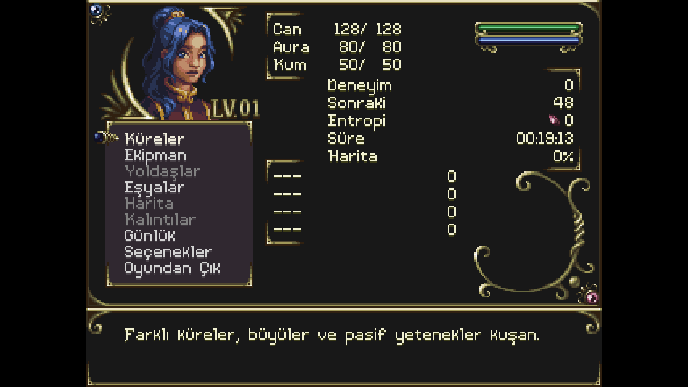
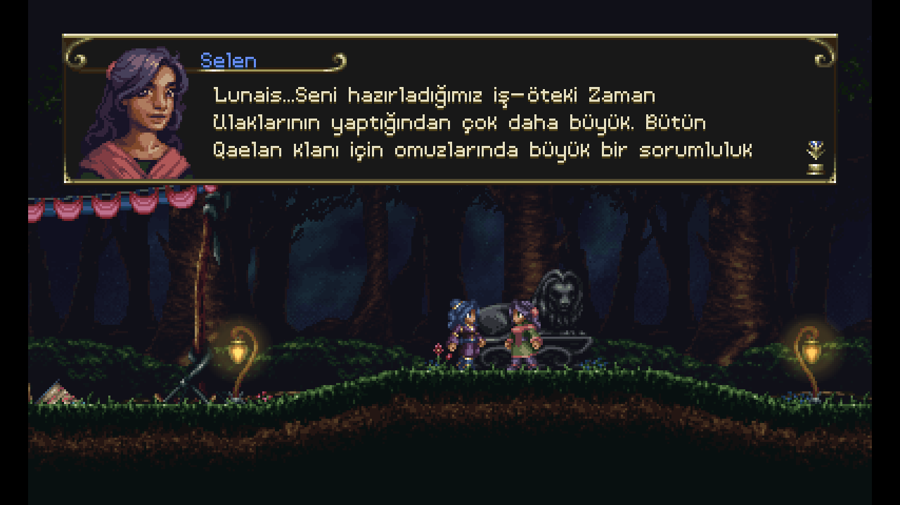

# Timespinner Türkçe Yama

Timespinner'a (Steam, Windows) **yeni bir dil olarak Türkçe** ekler. Dil menüsünde Türk bayrağıyla görünür; var olan hiçbir dilin yerini almaz.

- Menüler, envanter, günlük ve diyalogların tamamı Türkçeye çevrildi.
- Türkçe harfler (ç ğ ı İ ö ş ü) oyunda doğru görünür.
- Oyunda resim olarak duran bölge başlıkları ve seviye atlama yazısı ("LEVEL UP" yerine "Seviye Yükseldi") Türkçe karşılıklarıyla yeniden çizildi.

<p align="center">
  
  
  
</p>

Soldaki bayrak, dil menüsündeki kutunun araçla üretilmiş önizlemesidir; oyundan alınmış ekran görüntüsü değildir. Ortadaki ve sağdaki kareler oyundan alınmıştır. Diyalog karesinde büyük U ve D harflerinin solundaki küçük çıkıntı oyunun kendi yazı tipinin biçimidir.

**Çevirinin tamamı yapay zekâ (Claude) ile yapıldı;** bir insan çevirmen baştan sona okumadı. Terimler tek bir sözlükte toplandı ve tutarlılık için denetlendi, metnin bir kısmı örnekleme yoluyla okundu. Yanlış ya da kulağa garip gelen bir yer görürseniz [Issues](https://github.com/vechiron/TimeSpinner-TR/issues) bölümünden bildirin.

Hazırlayan: **Vechiron**

## ⬇ İndir

### [Kurulum programını indir (TimespinnerTR-Kurulum.exe)](https://github.com/vechiron/TimeSpinner-TR/releases/latest/download/TimespinnerTR-Kurulum.exe)

Başka bir şey kurmanız ya da komut yazmanız gerekmez: indirin, çalıştırın, kurulum kendisi yapar.

## Nasıl kurulur?

1. Yukarıdaki düğmeden **TimespinnerTR-Kurulum.exe** dosyasını indirin.
2. Çift tıklayıp çalıştırın. Windows "Bilinmeyen yayımcı" uyarısı verirse **Ek bilgi**ye, sonra **Yine de çalıştır**a tıklayın.
3. Açılan pencerede **1** yazıp Enter'a basın. Program oyunu kendisi bulur ve Türkçeyi kurar.
4. Oyunu açın, dil menüsünden Türk bayraklı seçeneği seçin.

Gereken tek şey: bilgisayarınızda Steam'den kurulu Timespinner (Windows).

## Sık sorulanlar

**Yamayı nasıl kaldırırım?** Kurulum programını yeniden çalıştırın, **1** yazıp Enter'a basın. Program oyunun özgün dosyalarını geri koyar.

**Oyun güncellenince Türkçe gitti.** Steam'in güncellemesi ya da "Oyun dosyalarının bütünlüğünü doğrula" işlemi yamalı dosyaları özgünleriyle değiştirebilir. Kurulum programını yeniden çalıştırın. Güncelleme oyunun dosyalarını değiştirdiyse program onları tanımaz ve hiçbir dosyaya dokunmaz; o zaman yamanın yeni sürümü gerekir (test edilen sürüm: Steam yapı numarası 24077286).

**Program oyunun klasörünü bulamadı, ne yapacağım?** Program klasörün yolunu sorar. Steam'de oyuna sağ tıklayın, **Yönet > Yerel dosyalara göz at** deyin; açılan pencerenin adres çubuğundaki yolu programa yapıştırın.

**Windows ya da antivirüs uyarı veriyor, güvenli mi?** Program dijital olarak imzalı olmadığı için Windows "Bilinmeyen yayımcı" der, bazı antivirüsler de "şüpheli" diyebilir. Bu bir yanlış alarmdır. Nedeni ve indirdiğiniz dosyanın buradaki sürüm olduğunu nasıl doğrulayacağınız sayfanın altında, **Geliştiriciler ve meraklılar için** bölümünde.

**Dosya neden 94,7 MB?** Program kendi içinde Node.js taşıyor. Oyunun hiçbir dosyası içinde yok.

Tüm sürümler: [Releases](https://github.com/vechiron/TimeSpinner-TR/releases)

---

## Geliştiriciler ve meraklılar için

Buradan sonrası kurulum için gerekli değil. Programın ne yaptığını, nasıl doğrulanacağını ve kendiniz nasıl derleyeceğinizi merak edenler içindir.

<details>
<summary><b>Antivirüs uyarısı ve dosya doğrulama</b></summary>

Bazı antivirüsler kurulum programını "şüpheli" olarak işaretleyebilir. Bu bir yanlış alarmdır, ama programın yapısı antivirüslerin gözünde zararlı yazılımlara benzer:

- İçinde başka bir program taşır: `TimespinnerTR-Kurulum.exe`, resmî Node.js v24.22.1 programının bir kopyasıdır; içine kurulum betiği eklenmiş, simgesi ve dosya bilgisi değiştirilmiştir. Dosyanın 94,7 MB olmasının nedeni budur.
- Oyunun `Timespinner.exe` dosyasının yamalı bir kopyasını üretip yerine koyar (özgün dosyanın yedeğini alır).
- Yamalı kopyayı üretmek için Windows'un C# derleyicisini (`csc.exe`, .NET Framework 4; Windows'ta hazır gelir) ve Mono.Cecil kitaplığını (MIT) geçici bir klasörde çalıştırır.
- Dijital olarak imzalı değildir.

Kurulum programının bütün kaynak kodu bu depodadır (aşağıda: **Depo düzeni**).

İndirdiğiniz dosyanın buradaki sürüm olduğunu karmasıyla doğrulayabilirsiniz: dosyanın bulunduğu klasörde PowerShell'e `Get-FileHash .\TimespinnerTR-Kurulum.exe` yazın. Çıkan değer aşağıdakiyle aynı olmalıdır (büyük/küçük harf fark etmez).

| dosya (v1.0.0) | SHA-256 |
|---|---|
| `TimespinnerTR-Kurulum.exe` | `65c8c33a7488de926d751b2f1ec4f80aa4591d2d36fd58b898fcac30b623f835` |
| `Node.js-LICENSE.txt` | `5888dbb9a1d2b18f2c3e6c5f6af1b39de658372b402a0577b002777f14c62ace` |
| `Mono.Cecil-LICENSE.txt` | `13d58ecbed676511c0c4c4009bff107025e50007ff5e7901dc562700ec62509e` |

Bu sürüm VirusTotal'a yüklenmedi; isterseniz dosyayı kendiniz yükleyip karmasını bu tabloyla karşılaştırabilirsiniz.

</details>

<details>
<summary><b>Program tam olarak ne yapar?</b></summary>

- Program oyunun hiçbir dosyasını içinde taşımaz. Yamalı dosyaları o an sizin bilgisayarınızdaki özgün dosyalardan üretir.
- Önce özgün dosyaların beklenen sürüm olduğunu karmasıyla denetler. Ürettiği her dosyanın da yamanın beklenen sonucuyla birebir aynı olduğunu denetler. Biri tutmazsa hiçbir şey yazmaz.
- Oyun klasöründe yalnız aşağıdaki dosyalara dokunur; ikisi özgün oyunda yoktur ve kaldırınca silinir:

  | dosya (oyun klasörüne göre) | ne yapılır |
  |---|---|
  | `Timespinner.exe` | yamalı kopyayla değiştirilir: dil listesine Türkçe eklenir |
  | `Content/Overlays/Menu/LocFlags.xnb` | dil menüsüne Türk bayrağı karesi eklenir |
  | `Content/Overlays/PlayerHUD/LocToastLatin.xnb` | "MAKS CAN+", "MAKS AURA+", "MAKS KUM+" bildirimlerinin Türkçe kareleri eklenir |
  | `Content/Overlays/PlayerHUD/LevelUp.xnb` | "Seviye Yükseldi" yazısının dört Türkçe karesi eklenir |
  | `Content/Overlays/Menu/PauseMenu.xnb` | duraklatma menüsündeki "LV." simgesi için Türkçe "SV." karesi eklenir |
  | `Content/TextureDatabase.dat` | yeni karelerin tanımları eklenir |
  | `Content/Overlays/PlayerHUD/AreaTitles_TR.xnb` | **yeni dosya:** Türkçe bölge başlıkları |
  | `Content/Localization/TR.txt` | **yeni dosya:** Türkçe metinler |

- Özgün dosyaların yedeğini `%LOCALAPPDATA%\TimespinnerTR\yedek` klasörüne alır; kaldırırken buradan geri koyar. Ne yaptığını `%LOCALAPPDATA%\TimespinnerTR\kurulum.log` dosyasına yazar. Oyun açıksa kapanmasını bekler.
- Yarıda kesilirse oyun ya özgün hâlinde ya da kayda geçmiş kurulu hâlinde kalır.

Komut satırından oyun klasörü ve veri klasörü verilebilir: `TimespinnerTR-Kurulum.exe --oyun "E:\Oyunlar\Timespinner" --veri "E:\TimespinnerTR"`.

</details>

<details>
<summary><b>Depo düzeni</b></summary>

| dosya | ne |
|---|---|
| `tools/kurucu.mjs` | kurulum programı: oyunu bulur, yamayı kurar ya da kaldırır |
| `tools/kurucu-uret.mjs`, `tools/kur-cekirdek.mjs` | yamalı dosyaları üretme; yedekleme, kopyalama, geri alma |
| `tools/ceviri.mjs`, `tools/terim-denetim.mjs` | `ceviri/` dosyalarından oyunun `TR.txt`ini üretme ve denetleme |
| `tools/icerik.mjs`, `tools/xnb.mjs`, `tools/bayrak.mjs`, `tools/bildirim.mjs`, `tools/baslik-ciz.mjs` | oyunun görsel dosyalarını yamalama: XNB okuma/yazma, dil menüsü bayrağı, üst sınır bildirimleri, bölge başlıkları |
| `tools/tr-yamaci.cs` | oyunun programına Türkçe dili ekleyen kod (kurulumda geçici klasörde derlenir) |
| `tools/oyun-yolu.mjs` | oyunun özgün dosyalarının yolunu bulur |
| `tools/kurucu-derle.mjs` | programı exe'ye derler ve sahte bir oyun klasöründe sınar |
| `tools/kurucu-varlik.mjs`, `tools/simge.mjs` | exe'ye gömülecek varlıkları üretir · programın simgesi (Türk bayrağı) |
| `tools/kurucu-sina.mjs` | kurulum programını sahte oyun klasöründe sınar (kur, kaldır, tanınmayan dosya, açık oyun) |
| `tools/il-dok.mjs` | Mono.Cecil'i indirir; yamacının derlenip derlenmediğini dener |
| `tools/varlik/` | bölge başlıklarının resmi ve kare tablosu |
| `ceviri/` | çeviri: her satır `anahtar = Türkçe metin` |
| `gorseller/` | bu sayfadaki görseller |

Oyunun kendi dosyaları bu depoda yoktur: programı derlemek ve çalıştırmak için oyunun sizdeki kopyası gerekir.

</details>

<details>
<summary><b>Kurulum programını kendiniz derlemek</b> (oyuncular için gerekmez)</summary>

Kurulum programını kendiniz derleyebilirsiniz. Gerekenler: Windows, oyunun sizdeki kopyası, internet bağlantısı (Mono.Cecil, esbuild, postject, resedit-cli ve iki lisans metni indirilir) ve Node.js v24.22.1 (`npm` ile birlikte gelir).

1. Oyunun **özgün** (yamasız) olduğundan emin olun. Yamayı kurulum programıyla kurduysanız önce programı çalıştırıp **1** ile kaldırın. Oyun Steam'in varsayılan klasöründe değilse klasörün yolunu `TIMESPINNER_OYUN` ortam değişkenine yazın; `steamapps\common\Timespinner` düzeni bozulmamalıdır, çünkü Steam yapı numarası bir üst klasördeki `appmanifest_368620.acf` dosyasından okunur.
2. Depo klasöründe sırayla şu iki komutu çalıştırın:

   ```
   node tools/il-dok.mjs yama-dene
   node tools/kurucu-derle.mjs --zincirsiz
   ```

İlk komut Mono.Cecil'i indirir ve yamanın oyununuza uygulanıp derlendiğini dener. İkincisi programı tek bir exe'ye derler, `ham/derleme/` klasörüne yazar (bu klasör depoya girmez) ve exe'yi sahte bir oyun klasöründe sınar. Her şey yolundaysa sınama `0 kaldı` der ve son satır `Derleme ve sınama tamam.` olur.

Sınamada bazı senaryolar atlanır (çıktıda `ATLANDI` yazar). Biri `--zincirsiz` yüzündendir: geliştirme makinesinde, exe'nin yazacağı dosyaların beklenen karmaları ayrıca çeviri ve resim araçlarının ürettiği dosyalarla karşılaştırılır; bu depoda o üretim zinciri yoktur, bu yüzden karşılaştırma atlanır. Öteki atlananlar exe'nin içine gömülü varlığı (bir çeviri satırı, beklenen karmalar, yamanın kaynağı) bilerek bozan senaryolardır; gömülü varlık değiştirilemediği için sınanamazlar.

**Aynı exe çıkar mı?** Bu sürümün exe'si, depo ayrı bir klasöre kopyalanıp yukarıdaki iki komutla yeniden derlendiğinde yukarıdaki tablodaki SHA-256 ile bayt bayt aynı çıktı. Bunun için iki koşul gerekir: aynı Node.js sürümü (v24.22.1; exe, derleyen Node'un bir kopyasını taşır) ve oyunun aynı sürümü (Steam yapı numarası 24077286; beklenen karmalar oyunun özgün dosyalarından çıkar). Karşılaştırma tek bir bilgisayarda ve tek bir Node.js sürümüyle yapıldı.

</details>

## Lisans

- Kod (`tools/`): MIT lisanslı, © 2026 Vechiron (bkz. `LICENSE`).
- Timespinner, yapımcılarının eseridir; oyunun kredilerinde yayıncı olarak Chucklefish yazar. Bu depo ve kurulum programı oyunun hiçbir dosyasını ve özgün (İngilizce) metnini içermez; `ceviri/` yalnızca Türkçe karşılıkları taşır. Bu metinler oyunun yazılarından türetildiği için oyunun hak sahiplerinin haklarına tabidir: yamayı yalnızca kendi oyununuzda, kâr amacı gütmeden kullanın.
- Bölge başlıklarının resmi Alegreya Italic (SIL Open Font License 1.1), "Seviye Yükseldi" resmi Fondamento Italic (SIL Open Font License) yazı tipiyle çizildi.
- Kurulum programı Node.js'i ve Mono.Cecil'i (ikisi de MIT) içerir; lisansları sürüm sayfasında exe ile birliktedir (`Node.js-LICENSE.txt`, `Mono.Cecil-LICENSE.txt`).
